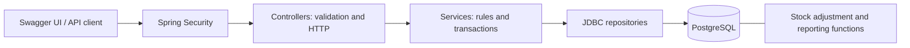

# Sentra Inventory Management

Sentra is an inventory management REST API for an automotive parts business. It separates product information from stock, controls employee access, and records administrative changes so stock movements can be traced to the employee who made them.

**Status: backend MVP complete.** Demonstrate the application through Swagger UI. The project includes PostgreSQL integration tests, a concurrent stock-removal test, and a live HTTP startup test.

## Features

- Product and car-part management with unique SKUs, categories and combined vehicle compatibility filters.
- Separate inventory records with stock initialization, additions, removals and absolute counts.
- Reorder thresholds, low-stock and out-of-stock reports, and inventory summary totals.
- Employee authentication and role-based access for administrators, managers, supervisors and staff.
- Server-generated audit history with actor, action, entity, timestamp and before/after values.
- PostgreSQL functions for atomic stock adjustment and low-stock reporting.
- Validated REST requests, meaningful HTTP errors, pagination and interactive OpenAPI documentation.

## Technology

| Area | Technology |
| --- | --- |
| Language and runtime | Java 24 |
| Application | Spring Boot 4.1.1, Spring MVC |
| Persistence | Spring JDBC / JdbcClient, PostgreSQL 17 |
| Security | Spring Security, HTTP Basic, BCrypt |
| Schema management | Flyway SQL migrations |
| API documentation | SpringDoc OpenAPI / Swagger UI |
| Testing | JUnit 5, Spring Boot Test, MockMvc, real PostgreSQL |
| Build and local database | Maven, Docker Compose |

The Maven artifact and Java package retain the original `OsyntraInventoryManagement` name.

## Engineering decisions

**Product and stock have separate responsibilities.** Product records describe the item; inventory records hold quantities and reorder thresholds. A unique product foreign key prevents duplicate inventory records.

**Stock updates are transactional.** Services lock product and inventory rows, call a PostgreSQL function to update stock, and write the audit entry in the same transaction. Database constraints and row locks prevent negative stock and conflicting concurrent updates.

**History survives product removal.** Deletion deactivates the product, preserving its inventory and audit trail. Active listings and reports omit deactivated products.

**Authorization follows employee responsibilities.** ADMIN and MANAGER administer products and stock; SUPERVISOR and STAFF can read them. Employee creation is restricted to ADMIN.



## Prerequisites

- JDK 24.
- Maven 3.9+.
- Docker Desktop running with Linux containers and Docker Compose.
- Local ports 5433 (PostgreSQL) and 8080 (application) available.

## Configuration

Run commands from the project root so both Spring and Compose find the environment file. On a fresh clone, copy the template:

```powershell
Copy-Item .env.example .env
```

On macOS/Linux, use `cp .env.example .env`. If `.env` already exists, edit it directly. Fill in the database password and both administrator values in **`.env`**. Editing `.env.example` does not configure the application.

| Variable | Purpose |
| --- | --- |
| POSTGRES_DB | Database created by Compose |
| POSTGRES_USER | PostgreSQL username |
| POSTGRES_PASSWORD | PostgreSQL password |
| DATABASE_URL | Optional JDBC URL override; default is jdbc:postgresql://localhost:5433/${POSTGRES_DB} |
| SENTRA_ADMIN_EMAIL | Email for the first administrator |
| SENTRA_ADMIN_PASSWORD | First administrator password: 12–72 characters and at most 72 UTF-8 bytes |

There are **no default application credentials or generated Spring Security passwords**. A custom `UserDetailsService` authenticates employees from PostgreSQL, so Spring's default user/password generation is disabled.

On startup, `SENTRA_ADMIN_EMAIL` and `SENTRA_ADMIN_PASSWORD` create an ADMIN only when the employees table is empty. Use that email as your Swagger username and the password you chose. These variables do not reset existing passwords or add administrators to an existing installation. After bootstrap, credentials are checked against the stored BCrypt hash; the bootstrap values can be removed from the environment.

If both administrator values are omitted on an empty database, the application starts without an employee account. Add both values to `.env` and restart. PostgreSQL credentials (`POSTGRES_USER` / `POSTGRES_PASSWORD`) are separate from application login credentials.

Secrets belong in local environment variables or `.env`, not source control. Git ignores `.env`; the publishable `.env.example` contains no passwords.

## Run

```powershell
docker compose up -d postgres
mvn spring-boot:run
```

Flyway automatically applies migrations before application startup. PostgreSQL persists in the existing Compose volume; the Spring application runs on the host.

- Swagger UI: http://localhost:8080/swagger-ui/index.html
- OpenAPI JSON: http://localhost:8080/v3/api-docs
- In Swagger, choose **Authorize** and enter your administrator email/password.
- Call `GET /api/auth/me` to verify login and view the current role.

Authentication uses stateless HTTP Basic with BCrypt password hashes. Each API request includes authentication; there is no separate token/login endpoint. Local HTTP is suitable for local testing; use HTTPS if exposing the API outside your machine.

The existing optional Dockerfile is not part of this verified host-run workflow.

## Test and package

Start PostgreSQL first, then:

```powershell
mvn clean test
mvn package
java -jar target/OsyntraInventoryManagement-0.0.1-SNAPSHOT.jar
```

Tests use real PostgreSQL and the same connection variables. They require permission to create schemas. API tests use the dedicated `sentra_mvp_test` schema and roll back their test data. The concurrency test commits temporary data and removes it afterward. The live-server test uses a fresh randomly named `sentra_smoke_...` schema, starts an actual HTTP server on a random port, verifies administrator bootstrap and Swagger, then removes that test schema. Do not use these schema names for application data or run multiple Maven test processes against the same database simultaneously.

The verified suite contains **17 tests with zero failures, errors or skips** (`mvn package`, 2026-10-26).

| Test suite | Evidence |
| --- | --- |
| [InventoryApiTests](src/test/java/org/osyntra/osyntrainventorymanagement/InventoryApiTests.java) | 14 invocations covering CRUD, stock changes, filters, reports, audit, validation, authentication, role restrictions and OpenAPI |
| [InventoryConcurrencyTests](src/test/java/org/osyntra/osyntrainventorymanagement/InventoryConcurrencyTests.java) | Two requests each remove four units from a stock of five: one succeeds, one returns 409, one unit remains and exactly one audit record is written |
| [LiveServerTests](src/test/java/org/osyntra/osyntrainventorymanagement/LiveServerTests.java) | Fresh schema migrations, administrator bootstrap, authenticated HTTP and Swagger UI on a running server |
| [Application context test](src/test/java/org/osyntra/osyntrainventorymanagement/OsyntraInventoryManagementApplicationTests.java) | Application context starts against PostgreSQL |

## Swagger workflow

1. Set the administrator environment values and start the application.
2. Authorize as that administrator and call `GET /api/auth/me`.
3. Create additional employees with `POST /api/employees` (ADMIN only):
   ```json
   {
     "firstName": "Sam",
     "lastName": "Worker",
     "email": "sam@example.com",
     "password": "choose-a-unique-test-password",
     "jobTitle": "Stock Clerk",
     "role": "STAFF"
   }
   ```
4. Create a category with `POST /api/categories`, for example `{"name":"BRAKING"}`.
5. Create a car part with `POST /api/products` using the returned category ID:
   ```json
   {
     "sku": "PAD-TOY-2018",
     "barcode": null,
     "itemName": "Front brake pads",
     "itemDescription": "Front axle brake pad set",
     "unitPrice": 45.50,
     "categoryId": 1,
     "make": "Toyota",
     "model": "Corolla",
     "year": "2018"
   }
   ```
   For a general product, omit all three of `make`, `model`, and `year`. For a car part, supply all three. SKU also serves as the part code; no redundant part-number catalogue was added.
6. Copy the returned `itemId`. Initialize its inventory with `POST /api/inventory/{productId}` and `{"quantityOnHand":10,"reorderLevel":3}`.
7. Add/remove stock using `POST /api/inventory/{productId}/add` or `/remove` with `{"quantity":2}`. Quantities must be positive.
8. Set an absolute count using `PUT /api/inventory/{productId}/quantity` and `{"quantity":0}`. Change the threshold using `PUT /api/inventory/{productId}/reorder-level` and `{"reorderLevel":5}`.
9. Search `GET /api/products?category=BRAKING&make=Toyota&model=Corolla&year=2018`.
10. View `GET /api/inventory?lowStock=true` or `?outOfStock=true`, then `GET /api/reports/summary`.
11. Inspect `GET /api/audit?entityId={productId}`.
12. Re-authorize as STAFF or SUPERVISOR: reads succeed, product/stock writes return 403.

## API behavior

| Endpoint | Purpose |
| --- | --- |
| GET/POST /api/products | List/filter or create general products/car parts |
| GET/PUT/DELETE /api/products/{id} | Retrieve, fully replace product details, or deactivate |
| GET/POST /api/categories | List or create database-backed categories |
| GET /api/inventory | Search/filter stocked active products |
| GET/POST /api/inventory/{productId} | Retrieve or initialize a unique inventory record |
| PUT /api/inventory/{productId}/quantity | Set stock count |
| POST /api/inventory/{productId}/add | Increase stock |
| POST /api/inventory/{productId}/remove | Decrease stock |
| PUT /api/inventory/{productId}/reorder-level | Set reorder threshold |
| GET /api/reports/summary | Active product count, stocked product count, units, low/out-of-stock counts |
| GET /api/reports/low-stock | Low-stock report |
| GET /api/reports/out-of-stock | Out-of-stock report |
| GET /api/audit | Administrative history; optional entityType and entityId |
| POST /api/employees | Create an employee (ADMIN only) |
| GET /api/auth/me | Current employee identity |

Product and inventory lists combine `search`, `category`, `make`, `model`, and `year`. Text search matches name, description and SKU; category/vehicle matching is case-insensitive. Inventory also accepts `lowStock` and `outOfStock`. Lists, reports and audit history use `limit` (default 50, max 200) and `offset` (default 0).

Products are deactivated rather than deleted, preserving inventory and audit history. Normal lists and reports exclude inactive products. Products can still be retrieved by ID or listed with `includeInactive=true`. An inactive product cannot be edited or receive stock changes. Product creation does not automatically initialize stock; use the explicit inventory endpoint.

Available quantity is on-hand minus reserved quantity. The existing reserved quantities are preserved during migration, but reservation management is outside this MVP. Low stock means available quantity <= reorder level; out of stock means available quantity = 0. Summary totalUnits counts on-hand units.

ADMIN and MANAGER manage products/categories/inventory and read reports/audit. SUPERVISOR and STAFF have read-only product/category/inventory access. Only ADMIN creates employees. No public self-registration exists.

Validation errors return 400, missing resources 404, duplicate/invalid stock state 409, unauthenticated requests 401, and restricted requests 403. Successful creation returns 201 and deactivation returns 204.

## Architecture and migrations

The application uses a layered MVC structure:

```text
src/main/java/org/osyntra/osyntrainventorymanagement/
    config/         Security, OpenAPI and administrator bootstrap
    controllers/    REST endpoints and exception handling
    dtos/           Validated requests and response records
    models/         Domain classes and role/status enums
    repositories/   Parameterized JDBC persistence and queries
    services/       Business rules, transactions and audit logging
src/main/resources/db/migration/
src/test/java/org/osyntra/osyntrainventorymanagement/
```

Controllers validate and delegate, services own transactions/business rules, and JDBC repositories use bound SQL parameters.

The original V1–V4 SQL filenames have one underscore rather than Flyway's required two, and contain incomplete SQL. They are preserved unchanged and remain ignored by default Flyway; its warning about those four files is expected. Do not rename them into active migrations.

- `V5__establish_base_schema.sql`: establishes the intended user/product/cart/order tables.
- `V6__separate_inventory_and_categories.sql`: categories, deactivation, unique stock records, legacy stock transfer, constraints and indexes.
- `V7__audit_and_inventory_functions.sql`: audit table and PostgreSQL functions.

`adjust_inventory(UUID, INT, BOOLEAN)` locks the inventory row, validates the new count, and updates it atomically. All backend quantity changes call it. `low_stock_inventory()` supplies low-stock queries/reports. Product and inventory locks plus service transactions keep concurrent stock changes and their server-generated audit records consistent. Audit history is written by the application; direct SQL maintenance outside it is not audited.

Clean schema migration and startup are covered by the live-server test. If importing a manually created legacy database, inspect its actual schema/history before choosing a Flyway baseline; automatic baselining is intentionally disabled.

## Scope and limitations

This release demonstrates a working backend MVP. It does not include a frontend, payment processing, a storefront, POS integration, multiple warehouses or cloud deployment. Existing cart/order tables are outside the active inventory workflow.

Authentication uses HTTP Basic rather than tokens or SSO. Employee editing, password recovery, product reactivation and reservation management are not implemented. Use HTTPS before exposing authenticated endpoints outside localhost. The optional Dockerfile is not part of the verified setup; Docker Compose runs PostgreSQL while Java runs on the host.

See [MVP_PROGRESS.md](MVP_PROGRESS.md) for the implementation inventory and handoff notes, and [README.Docker.md](README.Docker.md) for the database startup reference.
